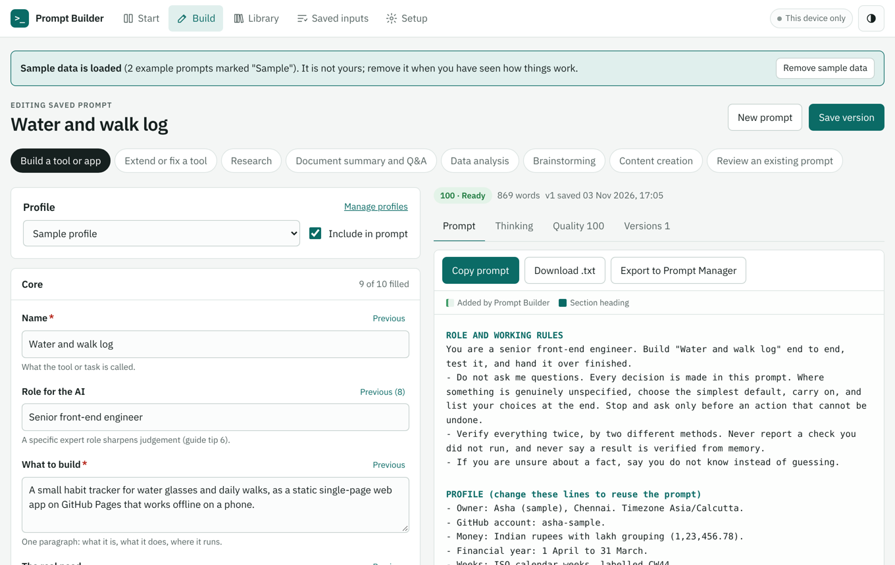

# Prompt Builder

Turn your needs into a copy-ready Claude prompt, with the AI's thinking explained beside it.

**Live:** https://sathyanarayanan-2001.github.io/prompt-builder/



Prompt Builder is a static web app. You describe what you need field by field; it writes the prompt in the same shape as a hand-made master prompt (role and working rules, profile, numbered sections, verify twice, known pitfalls, build order, final answer), shows how an AI will reason through it, scores it against the Claude prompting guide, and remembers every value you type so next time you pick instead of type.

## Features

- **Eight templates:** build a tool or app, extend or fix a tool, research, document summary and Q&A, data analysis, brainstorming, content creation, and review an existing prompt.
- **Built-in intelligence, offline:** eighteen smart rule packs fire on words you use (money, dates and weeks, sync, offline, phone, Excel, charts, GitHub, personal data, Python desktop, network, time tracking, databases, OCR, research links, verification, build order, handover). Each addition is highlighted in the prompt and can be switched off.
- **Thinking tab:** an eight-step walkthrough of how the AI will read the request, the three piles (decided, defaulted, open), eight questions the AI asks itself, and why each section exists.
- **Quality score:** eleven weighted checks from the prompting guide, a vague-word penalty, and a Fix button that takes you to the right field.
- **Every entry remembered:** each field has a Previous button with your earlier entries (pin the best ones) and suggestions. Profiles fill the PROFILE block.
- **Version history:** every save is a new version; view, compare line by line, load old inputs. Nothing is overwritten.
- **Learns from feedback:** on the Feedback tab, paste the AI's answer or describe what went wrong. Prompt Builder recognises 17 common problems (questions instead of work, placeholders, invented links, untested claims, ignored format, outdated versions, regressions and more) and proposes a lesson. A lesson either adds a step to future prompts, in a "Lessons from earlier answers" section, or warns you while you build a similar prompt. Repeated problems are counted, not duplicated.
- **Your data:** backup and restore (shows what will change, never deletes, can bring back what you deleted), Excel export (library, versions, saved inputs, lessons, feedback) and CSV, sample data you can remove in one tap.
- **Sync through OneDrive:** each device writes its own save file to a folder you choose and merges the others record by record; deletions travel too.
- **Installs and works offline;** light and dark themes; phone layout with bottom tabs.

## Privacy

There is no server, account, analytics or outside request. Your prompts live in your browser (IndexedDB) and in save files in a folder you choose. The page's Content-Security-Policy lets it load only its own files. `.gitignore` blocks backup, save and export files so personal data cannot be committed.

## Getting started

See [docs/SETUP.md](docs/SETUP.md) for laptops and the Android phone.

## Development

Requires Node 20 or later.

```bash
npm ci
npx playwright install chromium
npm start          # builds dist/ and serves http://localhost:8124
npm test           # round 1 unit tests, then round 2 browser tests
python tests/check_exports.py   # independent check of the Excel, CSV and backup files, after npm test
```

`npm run build` inlines the font, CSS and JavaScript into one `dist/index.html`. See [docs/ARCHITECTURE.md](docs/ARCHITECTURE.md).

## Licence

MIT. IBM Plex Sans is under the SIL Open Font License 1.1; see [THIRD_PARTY_NOTICES.md](THIRD_PARTY_NOTICES.md).
